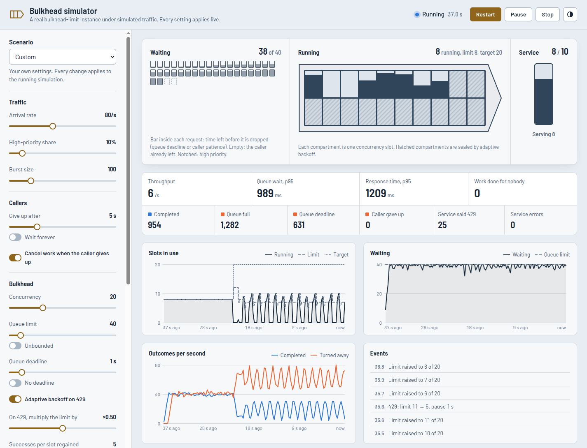

# bulkhead-limit

Concurrency limiter for Node.js and browsers with a bounded queue, queue-wait deadlines, cancellation, priorities and adaptive concurrency.

A plain concurrency limiter queues excess work without bound. Under sustained overload, queued tasks wait longer than their callers are prepared to, and they are often executed after the caller has gone. `bulkhead-limit` implements the [bulkhead pattern](https://learn.microsoft.com/en-us/azure/architecture/patterns/bulkhead): in addition to capping concurrency, it limits queue length and queue wait time, and rejects excess work immediately with a typed error.

- **Bounded queue**: past `maxQueueSize`, new work is rejected immediately (`QueueFullError`).
- **Queue-wait deadline**: work that waits longer than `queueTimeout` is dropped without running (`QueueTimeoutError`). This is separate from how long the task itself runs.
- **Abort-aware**: an `AbortSignal` that fires while a task waits removes it from the queue at once.
- **Priorities**: higher-priority work jumps the queue; equal priorities stay FIFO.
- **Runtime control**: resize, pause, resume and clear the queue while live.
- **Adaptive concurrency (AIMD)**: back off when the downstream pushes back (429, 503, "too many connections"…), honour `Retry-After`, and ramp back up as it recovers. Works with any transport.
- **Zero dependencies**, TypeScript-first, ESM + CJS. About 3.5 KB min+gzip (fetch helper: 0.5 KB).

```bash
npm install bulkhead-limit
```

## Simulator

[](examples/README.md#simulator)

[`examples/simulator`](examples/README.md#simulator) runs a real `Bulkhead` in the browser against a simulated downstream service. Traffic, caller behaviour, bulkhead settings and the service's latency, capacity and error rate can all be changed while the simulation runs.

In the screenshot, requests arrive at twice the service's throughput. The queue stays at its limit of 40, and excess requests are rejected by the queue limit or the 1 s queue deadline. At about 15 s, concurrency was raised from 8 to 20, above the service capacity of 10. The service then returned 429s, adaptive backoff lowered the limit, and throughput dropped by about half.

```bash
git clone https://github.com/cajax/bulkhead-limit.git
cd bulkhead-limit
npm install
npm run simulator   # http://localhost:4173
```

Preset scenarios:

- **Steady traffic:** load below capacity.
- **Traffic spike:** load above capacity, with a queue limit and deadline.
- **Rate-limited API:** the service accepts 6 concurrent requests, and adaptive backoff starts at 24.
- **Slow dependency, no limits:** no queue limit, no deadline and no cancellation. Requests that callers abandoned are still executed.

## Quick start

```ts
import { Bulkhead, isQueueFullError, isQueueTimeoutError } from 'bulkhead-limit';

const db = new Bulkhead({
  concurrency: 10, // at most 10 queries in flight
  maxQueueSize: 100, // at most 100 waiting; the 101st fails fast
  queueTimeout: 2_000, // nobody waits more than 2 s for a slot
});

app.get('/report', async (req, res) => {
  try {
    const rows = await db.run(({ signal }) => runReportQuery(signal), { signal: req.signal });
    res.json(rows);
  } catch (err) {
    if (isQueueFullError(err) || isQueueTimeoutError(err)) {
      return res.status(503).set('Retry-After', '1').end(); // reject excess load
    }
    throw err;
  }
});
```

## How it compares

|                                          | p-limit | p-queue | cockatiel `bulkhead` | **bulkhead-limit** |
| ---------------------------------------- | :-----: | :-----: | :------------------: | :----------------: |
| Concurrency cap                          |   ✅    |   ✅    |          ✅          |         ✅         |
| Change concurrency at runtime            |   ✅    |   ✅    |          —           |         ✅         |
| Bounded queue, fail fast when full       |    —    |   —¹    |          ✅          |         ✅         |
| Deadline on **queue wait**               |    —    |   —²    |          —           |         ✅         |
| Abort removes a waiting task immediately |    —    |   ✅    |          —³          |         ✅         |
| Priorities                               |    —    |   ✅    |          —           |         ✅         |
| Clear the queue                          |   ✅    |   ✅    |          —           |         ✅         |
| Adaptive concurrency (AIMD, Retry-After) |    —    |    —    |          —           |         ✅         |

¹ p-queue offers `onSizeLessThan()` so you can apply backpressure yourself. ² p-queue's `timeout` starts when the task starts running. ³ cockatiel checks the signal at submit time and when the task is dequeued. Checked against each project's README in November 2026. Corrections welcome.

For scripts that only need a concurrency cap, p-limit is sufficient.

## API

### `new Bulkhead(options)`

| Option                                            | Default    | Meaning                                                                        |
| ------------------------------------------------- | ---------- | ------------------------------------------------------------------------------ |
| `concurrency`                                     | (required) | Maximum tasks running at once (≥ 1).                                           |
| `maxQueueSize`                                    | unbounded  | Maximum waiting tasks. Beyond it, `run()` rejects with `QueueFullError`.       |
| `queueTimeout`                                    | none       | Maximum queue wait in ms. Beyond it, `run()` rejects with `QueueTimeoutError`. |
| `adaptive`                                        | off        | `true` or an [adaptive options](#adaptive-concurrency) object.                 |
| `onDispatch`, `onQueueTimeout`, `onQueueOverflow` |            | Called with `{ waitMs, queueSize }`.                                           |
| `onActiveCountChange`, `onPendingCountChange`     |            | Called with the new count.                                                     |

### `bulkhead.run(fn, options?)`

Runs `fn({ signal })` once a slot is free and resolves or rejects with its result. If the task never runs, `run()` rejects with:

| Rejection           | When                                                                              |
| ------------------- | --------------------------------------------------------------------------------- |
| `QueueFullError`    | `maxQueueSize` tasks were already waiting.                                        |
| `QueueTimeoutError` | It waited longer than `queueTimeout`.                                             |
| `signal.reason`     | The signal aborted before it started (an `AbortError` `DOMException` by default). |
| `QueueClearedError` | `clearQueue()` removed it (or the reason you passed to `clearQueue`).             |

Each error has a stable `code` (`ERR_QUEUE_FULL`, `ERR_QUEUE_TIMEOUT`, `ERR_QUEUE_CLEARED`) and a guard (`isQueueFullError`, …) that also works across duplicate copies of the package.

| Run option     | Meaning                                                |
| -------------- | ------------------------------------------------------ |
| `signal`       | Cancels the task while it waits; passed to `fn`.       |
| `priority`     | Higher runs first. Default `0`.                        |
| `queueTimeout` | Overrides the bulkhead's `queueTimeout` for this task. |
| `classify`     | Overrides the adaptive classifier for this task.       |

> **Abort during execution.** Once a task is running, aborting its signal does not free the slot. The slot is held until `fn` actually settles, so pass `signal` on to whatever you call. This is deliberate: freeing the slot early would start new work while the old work is still hitting the downstream, which defeats the bulkhead.

### Runtime control

| Member                                                             | Meaning                                                                                                                              |
| ------------------------------------------------------------------ | ------------------------------------------------------------------------------------------------------------------------------------ |
| `activeCount`, `pendingCount`                                      | Running and waiting tasks.                                                                                                           |
| `concurrency`                                                      | Current limit (below the target while adaptively throttled).                                                                         |
| `targetConcurrency`                                                | The limit adaptive control ramps back up to.                                                                                         |
| `setConcurrency(n)`                                                | Resize now (also sets the target). Waiting tasks fill new slots immediately.                                                         |
| `pause(ms)`, `resume()`, `isPaused`                                | Hold waiting tasks. A pause only ever extends; `resume()` ends it early.                                                             |
| `configure({ concurrency, maxQueueSize, queueTimeout, adaptive })` | Change settings live, for example from a config reload. Present keys apply (`undefined` clears a bound) and are all validated first. |
| `clearQueue(reason?)`                                              | Reject all waiting tasks, for example on logout or when a circuit breaker opens. Returns the count.                                  |

## Adaptive concurrency

With `adaptive` enabled, each finished task is classified as a **success**, an **overload** or **ignored**:

- **Overload**: concurrency is multiplied by `decreaseFactor` (not below `minConcurrency`) and dispatch pauses for `retryAfterMs` (or `fallbackCooldownMs`, capped at `maxCooldownMs`). Overloads within `decreaseWindowMs` count once, so a burst of failures from one event doesn't collapse concurrency to the floor.
- **Success**: every `successStep` consecutive successes add one slot, up to the target.

Feedback is applied before the finished task's slot is released, so the next waiting task already sees the reduced limit and the pause.

```ts
import { Bulkhead, parseRetryAfter } from 'bulkhead-limit';

const llm = new Bulkhead({
  concurrency: 8,
  queueTimeout: 30_000,
  adaptive: {
    minConcurrency: 1,
    decreaseFactor: 0.5,
    successStep: 5,
    classify: (outcome) => {
      if (outcome.ok) return 'success';
      const err = outcome.error as { status?: number; headers?: Headers };
      if (err.status === 429) {
        return { overload: true, retryAfterMs: parseRetryAfter(err.headers?.get('retry-after')) };
      }
      return 'ignore';
    },
    onThrottle: ({ previousConcurrency, newConcurrency, cooldownMs }) =>
      log.warn(`throttled ${previousConcurrency} → ${newConcurrency}, cooling down ${cooldownMs} ms`),
  },
});
```

The default classifier counts a resolved task as a success and ignores rejections. You can also report feedback manually with `bulkhead.reportOverload({ retryAfterMs })` and `bulkhead.reportSuccess()`, and clear all backoff state with `bulkhead.resetAdaptive()`.

| Adaptive option          | Default |
| ------------------------ | ------- |
| `minConcurrency`         | `1`     |
| `decreaseFactor`         | `0.5`   |
| `successStep`            | `5`     |
| `fallbackCooldownMs`     | `1000`  |
| `maxCooldownMs`          | `60000` |
| `decreaseWindowMs`       | `200`   |
| `onThrottle`, `onRampUp` |         |

## fetch

```ts
import { Bulkhead } from 'bulkhead-limit';
import { limitFetch } from 'bulkhead-limit/fetch';

const api = limitFetch(new Bulkhead({ concurrency: 5, maxQueueSize: 50, adaptive: true }));

const res = await api('https://api.example.com/items', {
  signal: AbortSignal.timeout(10_000),
  bulkhead: { priority: 10, queueTimeout: 1_000 }, // optional, stripped before fetch is called
});
```

The response is returned as-is (a 429 still resolves, as with plain fetch). With `adaptive` on, `429` and `503` count as overload and honour `Retry-After`, other statuses below 500 count as success, and other 5xx responses and network errors are ignored. Options: `fetch` (default `globalThis.fetch`) and `overloadStatuses` (default `[429, 503]`).

## Axios

See [`@cajax/axios-parallel-limit`](https://github.com/cajax/axios-parallel-limit).

## Examples

[`examples/`](examples) contains runnable scenarios: API load shedding, LLM rate limits, priority lanes, cancel on disconnect, graceful shutdown and stream backpressure. Each one runs the scenario with and without the bulkhead and prints the results.

## Building your own adapter

The pieces behind `Bulkhead` are exported for adapter authors:

- `BoundedLimiter<T>`: the slot and queue primitive. It is generic over a per-task context, with pluggable error factories and a `Cancellation` abstraction.
- `AdaptiveConcurrency`: the AIMD controller. It drives anything with `maxConcurrency`, `setMaxConcurrency()`, `pause()` and `resume()`.
- `PriorityDeque`: the bucketed linked-list queue. Enqueue, dequeue and unlink-on-abort are O(1) within a priority level.
- `parseRetryAfter(value)`: parses RFC 9110 delay-seconds or an HTTP-date into ms, or returns `undefined`.

## License

MIT
